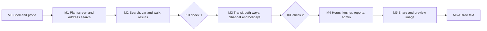
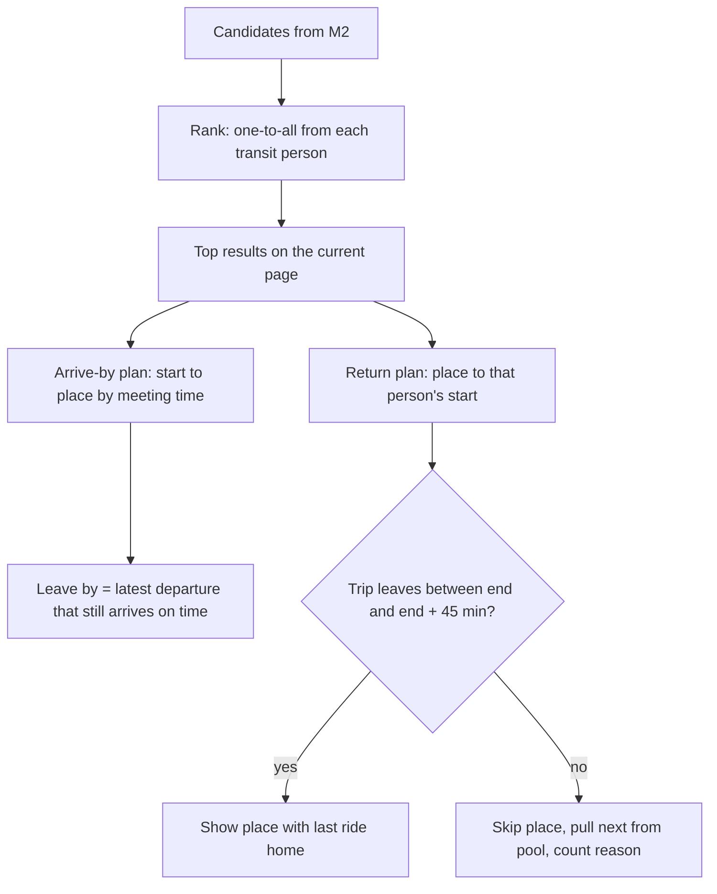

# Fair Enough: build plan (from spec v4, revised)

## What we're building

**Fair Enough** ("fair enough.") is a free, open-source, mobile-first web app for Israel. Two or three people say where each is starting from and how they travel (car, bus/train or walking), plus when they're meeting and for how long. The app returns places that are:
- about the same trip time for everyone
- open for the whole meeting
- reachable by a real bus or train home for anyone on transit

It handles Shabbat, holidays and kosher, and every plan can be shared on WhatsApp.

- **Address:** `fairenough.sticklight.app` (backup `fair-enough`). No custom domain.
- **Hard constraints:** free data sources only, with no paid fallbacks. OpenAI is the one paid API.
- **Languages and layout:** Hebrew and English (right-to-left and left-to-right), light and dark mode, usable from 360 px wide.

This project already runs on the server-rendered template the spec asks for, so share pages can carry their own WhatsApp preview tags.

---

## Build order (one milestone per approval)

The spec has check points between milestones (the M0 probe and kill criteria 1–3), so I'll build **one milestone at a time** and stop for your QA before the next. **Approving this plan starts M0 + M1.**

---

## M0: Shell, design, languages, themes, probe

### Design direction A, "Curb"

Based on Israeli curb paint: lines meeting at one point.

- **Fonts:** IBM Plex Sans Hebrew + IBM Plex Sans for the interface, IBM Plex Mono for times and minutes.
- **Light theme:**
  - Background: limestone `#F2EEE6`
  - Text: asphalt `#1E2124`
  - Accents: curb blue `#1F5FAF` and curb red `#C8372D`, on 10% of the surface or less
- **Dark theme:**
  - Background: `#14171A`
  - Text: `#E8E2D6`
  - Accents: `#6FA0E8` and `#E0695F`
- **Person route colours:** blue, red and ochre `#C9962B`, each also told apart by a dash pattern.
- **Shape:**
  - No cards. Results are full-width rows separated by a thin striped curb rule.
  - 2 px corners. Pills only for chips.
  - Each result has a "convergence bar": every person's line runs toward a centre dot, with length matching their minutes.
- **Motion:** route lines draw toward the place (300–450 ms), then the pin settles. Turned off when the device asks for reduced motion.
- **Banned:**
  - card grids
  - purple or indigo gradients
  - Inter on white
  - the ½ glyph
  - Rubik, Nunito and Fredoka
  - sparkles and mascots
  - logos that are only a map pin
- **Logo:**
  - The mark is two strokes meeting at a dot, one a hair longer than the other: fair, not perfect.
  - The wordmark is "fair enough.", where the full stop is the meeting dot.
  - Hebrew descriptor "המקום ההוגן להיפגש"; English "The fair place to meet."
- **Voice:** plain and dry. No jokes in safety, kosher or Shabbat text.

### Shell

- **Language toggle:** switches the page direction. Only back and forward icons are mirrored, never the map, clocks or logo.
- **Times and numbers:** isolated so they read correctly in Hebrew (e.g. "יוצאים ב-14:30, 25 דק׳"). Inputs handle mixed Hebrew and English.
- **Dates:** he-IL / en-IL formats, 24-hour clock, weeks start on Sunday.
- **Theme:** follows the phone's setting, with a manual switch saved on the device.
- **Map:** OpenFreeMap "Positron" in light mode and "Dark" in dark mode, switching with the theme. Attribution is always visible.
- **Pages:**
  - `/` — Plan
  - `/results`
  - `/s/:id` — shared plan
  - `/about` — sources, privacy notice, contact, licence
  - `/admin` — built in M4
- **Footer:** "© OpenStreetMap contributors · OpenFreeMap · Hebcal (CC BY 4.0) · Transitous sources", with links.
- **Page metadata:** title, description and social preview tags on every page.

### M0 probe (temporary, deleted afterwards)

**First results (25 Nov 2026, from the backend itself):**
- Runtime: Supabase edge runtime 1.79.1 (Deno 2.1.4), region eu-west-3.
- IP headers: `cf-connecting-ip` is set; `x-forwarded-for` starts with the same address. Forged-header test still to run from `/probe`.
- Hebrew PNG rendered in ~0.5–0.8 s (satori + resvg). Letter order still needs a visual check on `/probe`.
- Reachability: OSRM 200, Transitous 200, Hebcal 200. **Photon 403** (blocks the backend's cloud addresses). **Overpass 406** (needs a fix before M2).
- `/s/test` returns `og:title "probe-ok"` in the server HTML.

- **What I add:**
  - A test route `/s/test` with `og:title "probe-ok"`.
  - A public `probe` function that reports the runtime version and the incoming IP headers, and renders a Hebrew PNG.
- **Your part:**
  - Publish, then run `curl -A "WhatsApp/2.23" https://fairenough.sticklight.app/s/test`.
  - Call the probe from your phone on mobile data and on Wi-Fi.
  - Try a forged `x-forwarded-for` to see whether the IP can be faked.
  - We record the results in the open questions.

---

## M1: Plan screen and address search (`geo` function)

### Plan screen

- **People rows:** two to start, and a third can be added (3 maximum).
  - **Address field:** Hebrew and English autocomplete, limited to Israel. It waits 400 ms after typing.
  - **Mode icon:** tapping cycles car → public transport → walk; long-press opens a small menu. Screen readers hear "Mode: public transport" / "דרך הגעה: תחבורה ציבורית".
  - **Use my location:** on row 1 only, with the spec's one-time notice. The location isn't saved.
- **Summary line:** "Meet at · For · Occasion · What · Kosher". Each item opens a bottom sheet with defaults already filled in.
  - **When:**
    - "Meet at" is the arrival time. The default is the next round half hour, and past times are blocked.
    - "For" is 30 min / **1 h (default)** / 2 h / 3 h / custom.
  - **Occasion:** Date / Friends / Family. It only pre-selects chips, can be undone, and never removes a chip.
  - **What:** every chip is always visible, in two groups. Thin-data chips carry a small "few listed" mark.
    - **Eat & drink:** cafe, sit-down restaurant, fast food, falafel/shawarma, pizza, burger, sushi/Asian, Italian, ice cream, bakery, bar/pub.
    - **Do something:** park, picnic/BBQ, beach, viewpoint, museum, gallery, cinema, theatre, mall, zoo/aquarium, climbing gym, bowling, escape room, pottery/ceramics, trampoline park, karaoke, laser tag/paintball, karting, amusement/water park, workshop.
  - **Kosher:** Off / Kosher, with the spec's ⓘ tooltip.
- **Search button:** disabled until every row has a picked suggestion.
- **Privacy:** addresses never appear in the URL.

### `geo` function (`suggest`, `reverse`)

- **Shared "guard v1" block.** The same block opens all four functions:
  - accepts requests from the app's own address and its preview only
  - reads inputs from the request body only
  - validates every input
  - hashes the IP with a daily salt; raw IPs are never stored
  - keeps per-minute and per-day counters
- **Address search tries four sources in order:** Photon → Geoapify → LocationIQ → HeiGIT.
  - Each one gets a 2 s timeout and its own daily cap.
  - The dropdown shows the attribution for whichever source answered.
- **Reverse lookup:** turns a point into a neighbourhood name, cached for 30 days.
- **Limits:**
  - suggest: 60/min and 800/day per IP; 40/min and 8,000/day overall
  - reverse: 10/min per IP; 500/day overall

### Database (one change, everything locked down)

- **Function access only:** `rate_counter` and its counter function, `cache`, `search_pool`, `share_snapshot`, `report`.
- **Public read, admin write** (once admin exists): `venue_override`, `activity_extra`.

### Secrets you'll add

- **Now:** `GEOAPIFY_KEY`, `LOCATIONIQ_KEY`, `HEIGIT_KEY`, `IP_HASH_SECRET`.
- **Later:** `OPENAI_API_KEY`, `TURNSTILE_SECRET`.

---

## M2: Search, car and walk, results, Load more (`search` function)

- **Search area:**
  - Centred on the middle point between everyone and on each midpoint between two people.
  - Radius = 15% of the longest distance between two people, kept between 1.5 and 6 km.
- **Finding places:**
  - One query to OpenStreetMap (Overpass) for the chosen chips, plus imported activities. Places within 75 m of each other with similar names count as one.
  - Results are cached for 7 days.
  - It keeps up to 80 named places, then the 40 closest to the centre.
  - The chip-to-tag table and name-keyword sets come straight from spec 3.6 and M2.
  - Name keywords are never matched on bus stops or roads, or on tile, DIY, bathroom, building-materials or kitchen shops.
- **Drive and walk times:**
  - Sources tried in order: OSRM (FOSSGIS) → Valhalla → HeiGIT → a straight-line estimate labelled "rough estimate".
  - "Leave by" = meeting time − travel time − 5 min.
  - Each person's trip is capped at 60 min, or 90 if the longest drive between two people is over 90 min.
- **Ranking:**
  - Score = longest trip + half the gap between the longest and shortest trip. Lower is better.
  - Places that fit the occasion get 3 points off.
- **Results:**
  - Up to 25 are stored for 2 hours; 5 show at a time.
  - A map with numbered place pins and this device's start pins.
  - Each row shows everyone's minutes and mode icons, the gap, the hours status, and Waze, Google Maps and Moovit links.
  - **Load more** makes no new outside calls for car and walk. When the list runs out: "That's everything nearby. Search a wider area?" (radius × 1.6).
- **Loading and error states:** as in spec 4.3, including a zero state that names the main blocker and offers up to 2 one-tap fixes.
- **Then kill check 1:** replay 10 real past meetups.

**Built (25 Nov 2026):**
- `search` function deployed with actions `search` and `more`, guard v1 copied in, all limits from 5.8.
- Both public Overpass servers were refusing every request all day ("at capacity"). Fallback added: Geoapify Places (same OpenStreetMap data, existing free key), then the place cache. A 10-minute pause skips Overpass after both servers fail, so searches don't wait on timeouts.
- OSRM holds back-to-back requests for ~10 s; the timeout is 12 s, then Valhalla, then HeiGIT, then the labelled straight-line estimate.
- Bus/train minutes in M2 are the labelled "estimate" (straight line ÷ 25 km/h + 10 min). Real timetables arrive in M3.
- Kosher in M2 shows listed-kosher food places only; the fallback banner comes in M4.
- Photon moved to the end of the address chain (it blocks cloud servers).

---

## M3: Transit both ways, Shabbat and holidays

### Ranking (getting there)

- For each transit person, one search to every reachable stop (Transitous one-to-all).
- A place's minutes = earliest arrival at a stop within 500 m, plus walking at 80 m/min. Arrival must be by the meeting time.
- This is used only to **rank** places, not to give the departure time.

### "Leave by" from a real arrive-by plan (fix 2)

- For each place on the current page, one arrive-by trip plan per transit person, from their start to the place, arriving by the meeting time.
- "Leave by" is that plan's **latest** departure that still gets there on time, so nobody is told to leave too early.

### Ride home: a real trip back to each person's start (fix 1)

- For each place on the current page, one trip plan per transit person, **from the place back to that person's own starting point**, departing at the meeting end.
- The place passes only if that trip's first departure is between the meeting end and 45 minutes after it.
- Otherwise the place is skipped and the next one from the pool is checked instead. The reason is counted for the zero state and for the "Hidden: 3 places with no bus home after 22:00" line.
- A bus that just happens to leave nearby in the wrong direction no longer counts.

### Reuse and call budget

- These are the same trips as the exact itinerary, so tapping a place shows its itinerary with no extra calls.
- **Trips are planned only for the 5 places on screen.** Nothing is planned for the rest of the 25 up front; tapping Load more plans trips for the next 5 (approved 25 Nov 2026).
- **Worst case per search** (3 transit people, 5 results): 6 ranking calls + 30 plan calls ≈ 36, plus extra checks when places get skipped.
- That's well above the spec's earlier estimate of ≈10 per search. Under the self-imposed 650/day Transitous cap, roughly **18–20 all-transit searches a day**, fewer if places get skipped. Mixed groups (one person driving) cost about half.
- Above the cap, transit switches to the labelled "estimate" mode with no ride-home claims.
- *(Worth deciding during M3 QA whether that daily volume is enough for you.)*

### Shabbat and holidays (fix 3)

- **Exact times:** Hebcal for the meeting start and end (rounded location, cached).
  - If either falls inside Shabbat or a Yom Tov, show the banner and the button "Try {time}, after Shabbat" (end time + 30 min).
- **Holiday calendar:** one call per year fetches Hebcal's yearly holiday list, cached for 30 days.
  - If Hebcal's time lookup is down, the app still knows which days are Shabbat and Yom Tov from this list.
  - Only the exact start and end times become approximate. Those days (and the evening before) are marked "possibly Shabbat/holiday", with a warning.
- **Last resort:** Fri 12:00 – Sat 20:00 is used only if the cached list is also unavailable.

### Wording and final check

- The EN/HE text for leave-by, last ride home and no ride home is copied from spec 4.4.
- **Then kill check 2:** 10 trips compared against Moovit in both directions, ride home included.

---

## M4: Hours, kosher, reports, admin

### Opening hours

- Places open for the whole meeting show "Open for your whole meeting".
- Places that close during the meeting are excluded.
- Places with no hours data show "Hours unknown. Call before you go." and rank lower.

### Kosher

- **Which source wins, in order:** your override → an approved report → OpenStreetMap's kosher tag (`diet:kosher`) → "No kosher info".
- **Fallback:** if fewer than 3 kosher-listed places are found and the meeting isn't on Shabbat or a holiday, up to 7 "No kosher info" places are added under the warning banner. These are never added:
  - places listed as not kosher
  - seafood, shellfish or pork places
  - bars, unless the bar chip is picked
  - places that open on Shabbat
- **On Shabbat or a holiday with kosher on:** no fallback.
- **Other rules:** kosher filters food chips only. The word "certified" is never used.

### Report a problem (`feedback` function)

- **Types:** kosher wrong / closed / hours wrong / other, with up to 280 characters.
- **Protection:** Turnstile. Text with links is rejected.
- **Limits:** 5/hour and 20/day per IP. A place is auto-flagged after 5 or more reports in a day.

### Admin (Google sign-in, locked to `miriamroskind@gmail.com`)

- **Venue override editor**, with a reminder to also fix the place in OpenStreetMap.
- **Reports inbox:** approve or reject.
- **Usage view.**
- **"Import activities" page:** upload the Overture JSON, preview the counts per chip, then import. Each row has a Hide button.
- **Credit:** "Overture Maps Foundation" appears in the footer whenever an imported place is on screen.

---

## M5: Share and WhatsApp preview (`share` function, public)

- A place whose bus ride home couldn't be checked (`shareHomeUnchecked(v)` in `src/lib/search-client.ts`) is still shareable; its share card line says "bus home not checked" (`shareHomeUnchecked` text).

- **Creating a share:**
  - The snapshot expires 30 days after the meeting ends.
  - **Only filled-in results.** Share is disabled while bus/train trips are still being filled in (`shareableVenues()` returns null), and faded "hidden" places are left out. The server also refuses to snapshot any place still marked rough. The preview image and WhatsApp text use the same snapshot, never the first rough pass.
  - Start pins are rounded to about 11 m and **shown by default**.
  - A "Hide starting points" toggle (off by default) shows area names instead. The share note text comes from the spec.
- **`/s/:id` page:**
  - Server-rendered with a title, description and image for each share, in the share's language. Venue names are made safe before going into the page.
  - Shows the places, times and start pins (unless hidden), and a "Plan your own" button.
  - Expired or unknown links show "This plan has ended. Plan a new one."
- **Preview image:**
  - 1200×630, under 300 KB, light theme.
  - Top 3 places with everyone's minutes, Hebrew right-to-left.
  - If rendering fails, a static image for each language is used instead.
- **WhatsApp message:** the text itself lists the top 3 places, everyone's minutes and the time, so it's useful even if the preview fails. There's also a "Copy link" button.

---

## M6: AI free text

### Before building: model check (fix 4)

- Before M6 starts, a single test call checks that `gpt-6-luna` is enabled on your OpenAI account.
- If it isn't, I'll use the cheapest model on your account that supports structured outputs, and update the cost line in the spec.

### The feature

- **"Describe it (optional)" box:** up to 200 characters, e.g. "חמישי ב-20:00 לשעתיים, משהו חלבי ושקט, כשר".
  - It pre-fills chips, time, length, occasion and kosher. You can see and change every value.
  - If anything goes wrong, it silently falls back to the chips.
- **Guardrails:**
  - The model can only answer from a fixed list of allowed values.
  - It treats the text as data, never sees venue data and never decides anything about kosher.
- **Limits:** 3 s timeout; 10/min and 50/day per IP, 300/day overall.
- **`/admin/eval`:** runs the 70 test phrases you paste and checks them against the spec's pass bar.

---

## Notes

- **How the share page loads its data:** the project rules prefer calling backend functions from the browser. For `/s/:id`, the server makes one plain public request to the `share` function, with no secrets and no login. That keeps shares unlistable while still giving WhatsApp the preview tags in the page itself.
- **Admin:** locked to `miriamroskind@gmail.com`. Google sign-in has to be turned on in Cloud → Auth users.
- **Things only you can do:**
  - run the M0 probe checks
  - sign up for the free API keys
  - create the Turnstile widget
  - set the $2 OpenAI budget limit
  - pick the `fairenough` subdomain in Publish
  - create the public GitHub repo with an open-source licence
- **Not included (agreed cuts):** accounts for regular users, ratings, 4+ people, a budget filter, bike/scooter, live traffic, and any paid fallback.

## Transitous compliance and call budget (Nov 2026)

- One source for everything Transitous: `supabase/functions/_shared/transitous.ts` (`TRANSITOUS_API = https://api.transitous.org/api/`, `APP_VERSION`, `USER_AGENT`, 650/day cap, call log). Edge functions deploy as single files, so `node scripts/sync-shared.mjs` copies it into each function between `shared:transitous` markers; run it after any edit (`--check` verifies). **Bump `APP_VERSION` on every release.**
- Never use staging or the internal servers behind the load balancer.
- Trip cache: start snapped to a ~150 m cell, place id, mode, direction (there/home), 15-minute slot; 6 hours. Ranking (one-to-all) cached the same way. Hits make no call and don't count toward 650. Same lookup running twice in one instance is shared.
- Fill-in only plans rows the device has already been sent (visible page plus Load more batches).
- Every lookup outcome is logged in `transit_call` (no coordinates): ok / hit / shared / dropped / skip / cap / timeout / refused / dns / tls / network / 4xx / 429 / 5xx.
- Diagnostic: `/diag/transit?key=<DIAG_KEY>` (unlisted, noindex; 404 without the key). One run a minute, 1 server call + 1 browser call, not a search.
- Unchanged: 3 at a time, 3 s per lookup, 4 s queue drop, 15-minute skip rules, two fill-in passes.

- Brand package B2 (from fair-enough-B2-final.zip) lives in `src/assets/brand/`; favicons, app icons, manifest and `og-image.png` in `public/`. `public/favicon.svg` is the package favicon with a `prefers-color-scheme` switch (light #B85A00/#1F6FD1, dark #FFAA55/#64A5FA). When the redesign brief is applied, use the B2 lockup/symbol/wordmark from `src/assets/brand/` instead of the logo in section 2 of the brief. og:image must stay absolute (`OG_IMAGE` in app-head.ts).
